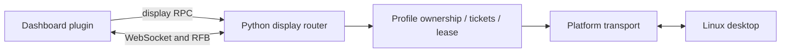

# Hermes Dashboard, Desktop, and Bot Screen architecture

[繁體中文](ARCHITECTURE.md) | **English**

This describes the bundled source snapshot and integration, not every upstream release. The original static analysis used Hermes commit `62629e285614db8cdcc9c48b6732b89d584def68`. Later installation and runtime evidence is recorded separately under `evidence/`.

## Applications and frameworks

Dashboard is the browser application under `hermes/web/`: React 19, TypeScript 6, Vite 8, Tailwind 4, and `@nous-research/ui` in this snapshot. Pages, components, themes, and contexts belong to this web frontend. It communicates with the Python backend through HTTP APIs, RPC, WebSockets, and terminal sessions.

Hermes Desktop is a separate Electron application with its own React renderer, preload bridge, main process, and state management. Renderer access to native capabilities passes through preload IPC. It shares protocols and utilities from `apps/shared` and Python Agent capabilities, rather than embedding the Dashboard frontend or sharing every page. Its headless backend fallback does not make the two frontend bundles identical. The separate bootstrap installer is another application.

The Python backend separates web-server responsibilities, routers, Dashboard authentication, Agent execution, tools, providers, and profile data. The messaging Gateway is distinct from the Dashboard process and its RPC connections.

## Bot Screen data flow

Bot Screen is a Dashboard plugin with a prebuilt JavaScript bundle, scoped CSS, locale dictionaries, and noVNC for desktop rendering. It uses Hermes Dashboard SDK integration rather than another frontend server. The Agent and browser share the backend desktop and control-ownership rules.

Display RPC handles status, startup, and control acquisition/release. The RFB WebSocket uses one-time tickets. Server-side input filtering and the control lease enforce who can type or click; hiding browser controls is not the security boundary. Reconnection starts in view mode and does not bypass an existing lease.

Windows and Linux Dashboard hosts use platform-specific locks and stream adapters. The desktop remains Linux, either in Docker or native Linux mode. Docker reconnect checks the exact container identity and profile ownership. See [cross-platform details](CROSS_PLATFORM.en.md).

## Source navigation

- `hermes/web/`: Dashboard SPA, API clients, gateway client, pages and components.
- `hermes/apps/`: Desktop application and shared protocols/utilities.
- `hermes/hermes_cli/web_routers/display.py`: display endpoints and streaming authorization.
- `hermes/tools/bot_desktop/`: desktop runtime, ownership lease, and transport.
- `bot-screen-plugin/src/`: plugin UI, noVNC integration, styling, and localization.
- `installer/`: guarded integration into a compatible existing Hermes installation.

The Chinese document retains the original static-analysis history. Current installation is described in [the installer guide](ONE_CLICK.en.md). Runtime acceptance is limited to the environments explicitly recorded in evidence; source analysis alone does not prove deployment.
