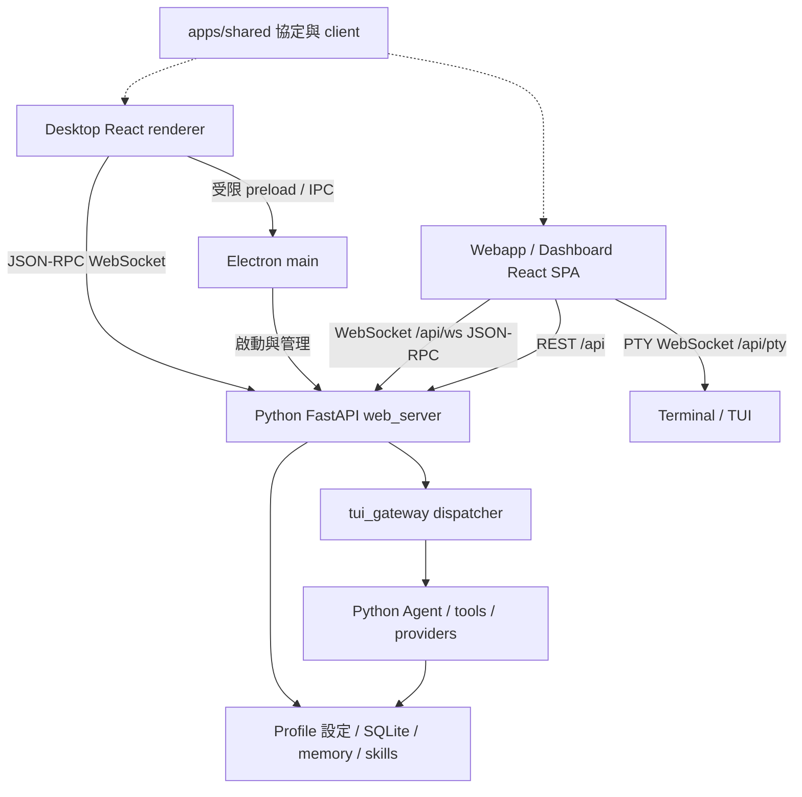

# Hermes Dashboard、Desktop 與 Webapp 架構分析

> 後續整合更新：Bot Screen plugin 已納入本目錄，透過隔離 profile 掛入這份 Webapp。操作方式與實測範圍見 [INTEGRATION.md](INTEGRATION.md)；下文「尚未整合／尚未執行」敘述保留為最初架構分析的歷史狀態。

分析日期：2026-10-27。依據本機實際安裝的來源快照，commit `62629e285614db8cdcc9c48b6732b89d584def68`。以下是程式碼與專案文件的靜態分析，不代表本目錄已成功執行。未把本機舊 checkout 或 Windows 安裝助手當成這個版本。

## 核心結論

Dashboard 就是 `web/` 這套瀏覽器 Webapp。Desktop 是獨立的 Electron 原生應用，擁有自己的 React renderer；它沒有直接把 Dashboard 網頁嵌進 Electron。兩者重用 `@hermes/shared` 的協定／工具與相同 Python Agent 後端，並非共用所有頁面或同一個前端 bundle。

圖中 PTY 通道由 HTTP 後端處理後接到終端；它不是 Desktop 的聊天 renderer。WebSocket 的 URL 與認證可經 Electron bridge 取得，並不代表所有 RPC 都經 IPC 傳送。

## Webapp / Dashboard

| 層 | 主要位置 | 責任 |
|---|---|---|
| 應用入口與導覽 | `hermes/web/src/main.tsx`、`App.tsx` | React 路由、頁面 lazy loading、側欄與 profile scope |
| 功能頁 | `hermes/web/src/pages/` | 狀態、聊天、設定、模型、sessions、排程、工具、skills 等管理介面 |
| HTTP client | `hermes/web/src/lib/api.ts`、`api-*.ts` | REST、base path、session header、WebSocket ticket |
| 即時 client | `hermes/web/src/lib/gatewayClient.ts` | 繼承共用 JSON-RPC client，連線 `/api/ws`，接收事件與 delta |
| 主題與元件 | `components/`、`themes/`、`contexts/` | UI、外觀、頁面與 profile 狀態 |
| 建置 | `hermes/web/vite.config.ts`、`scripts/build/web.mjs` | Vite、React compiler、分塊、build 資源限制、靜態產物 |

版本由 package.json 鎖定：React 19、TypeScript 6、Vite 8、Tailwind 4、`@nous-research/ui`。開發端的 API 與 dashboard plugins 代理至後端；生產端由 Python 提供編譯好的 SPA。後端注入 base path、認證與啟動資訊，因此直接打開 index.html 不能取代完整服務。

新版 `dashboard-flags.ts` 明確將 embedded chat 設為常態開啟，和舊版需 `--tui` 才開的行為不同。Webapp 同時包含 JSON-RPC 與 PTY 通道，不能將整套 Webapp 簡化成 xterm 終端頁。

## Desktop

| 層 | 主要位置 | 責任 |
|---|---|---|
| 原生主程序 | `hermes/apps/desktop/electron/main.ts` 與同目錄模組 | 視窗、backend 探測與生命週期、原生檔案／Git、更新、平台政策 |
| 能力橋接 | `hermes/apps/desktop/electron/` preload 相關模組 | 向 renderer 暴露具體且受限的能力 |
| React renderer | `hermes/apps/desktop/src/` | 自有聊天、路由、分割面板、預覽、檔案與設定互動 |
| 狀態 | `hermes/apps/desktop/src/store/` | 連線、profiles、sessions 與視窗呈現狀態；後端資料是快取而非權威副本 |
| 連線政策 | `src/lib/gateway-ws-url.ts`、`gateway-rpc.ts` | connection/profile 綁定、ticket URL、舊後端能力判斷 |
| 打包 | `hermes/apps/desktop/package.json`、`BUILDING.md` | Electron build、平台封裝與 agent payload |

聊天呈現使用 `@assistant-ui/react`。renderer 不應直接取得任意 Node/Electron 能力；本機能力由 preload/IPC 控制。Agent 行為由後端負責，不在 React 重寫工具調用或模型循環。

依 Desktop README，新版本啟動 headless `hermes serve`，提供 `tui_gateway` 的 JSON-RPC/WebSocket API；舊 runtime 不支援 serve 時可退回 `dashboard --no-open`。這是後端命令相容策略，不表示 Desktop 顯示 dashboard UI。

支援本機、遠端與 cloud 連線。bundled 安裝包使用自帶 payload；source/bootstrap 另有來源探測與安裝流程。`apps/bootstrap-installer` 是另一個 Tauri/Rust 安裝入口，不是 Electron Desktop 本體。本機 `Hermes-pkg` 的非官方 Windows 安裝助手也屬另一專案。

## 共用後端與資料邊界

- `apps/shared/src/json-rpc-gateway.ts` 與 `json-rpc-channel.ts`：RPC client、連線及事件處理；generated gateway contract 定義共用協定。
- `hermes_cli/web_server.py`：FastAPI 組裝入口；`web_server_*.py` 分離生命週期、設定、sessions、gateway、排程等 concerns。
- `hermes_cli/web_routers/`：HTTP 與 WebSocket routes；`web_server_boundary.py` 與 `dashboard_auth/` 處理主機與認證邊界。
- `tui_gateway/`：將 UI 的 RPC 連到 Agent，和 Telegram 等訊息平台的 `gateway/` 是不同層，不應只因名稱相近而混用。
- `run_agent.py`、`agent/`、`model_tools.py`、`tools/`、`providers/`：Agent 執行、工具分派與模型供應商；SQLite 的 session/state 模組在 `hermes_state*.py`。
- `HERMES_HOME` 決定使用者／profile 資料位置。複製來源不會複製 runtime 狀態；但直接啟動未隔離的新來源仍可能讀寫預設資料位置。

Browser API 用 `X-Hermes-Session-Token`；受 gate 保護的 WebSocket 使用單次 ticket。Desktop 的連線描述還包含 connection/profile scope。擴充時應沿用這些邊界，不能只把 API URL 換成遠端主機就視為完整遠端支援。

## Bot Screen 在這個架構中的位置

此快照已有 `tools/bot_desktop/`、`web_routers/display.py` 等桌面顯示／控制相關基礎。另一個本機專案 `<USER_HOME>\Projects\hermes-bot-screen-lab` 有獨立 dashboard plugin 與 Linux 修復候選，但那份實驗成果不包含於此 Git 快照，也沒有在本次覆蓋進來。

建議接續方式：

1. 先把 `web/` 作為 Bot Screen 的瀏覽器管理介面，透過 dashboard plugin 或既有 display routes 擴充，避免另造一份 sessions／profiles 管理。
2. 螢幕串流、控制權 lease、輸入與 sandbox process 生命週期留在 Python 後端；前端只維持呈現與互動狀態。
3. 若日後需要原生系統能力，再做 Desktop plugin／preload 能力；只需要瀏覽器畫面時，可先不維護第二套 Electron UI。
4. 在隔離 profile 驗證認證、連線重建、控制權收回與停止行為，再判斷是否整合 lab 修復。原有 lab 的 Linux 成功不能當成這個目錄或 Windows 的驗收。

## 搬入與驗證範圍

保留完整上游 monorepo 是為了 workspace 與 Python import 相依性；不是聲稱所有模組都由 Bot Screen 使用。`source-manifest.json` 記錄來源與檔案 Git blob；`verification.json` 記錄搬入後逐檔比對結果。上游 LICENSE 保留。

本次沒有執行 npm install、Python 環境配置、完整 build、測試套件、服務啟動或 GUI 驗收。因此交付狀態是「原始碼架構已搬入且內容驗證完成」，不是「Dashboard／Desktop 已可用」。

完整性結果：19,699 個追蹤檔案全部通過。38 個 PowerShell 檔案依上游 `.gitattributes` 的 `eol=crlf` 匯出，核對時正規化換行後比對 Git blob，其餘按原始 bytes 比對。詳細結果見根目錄 `verification.json`。
