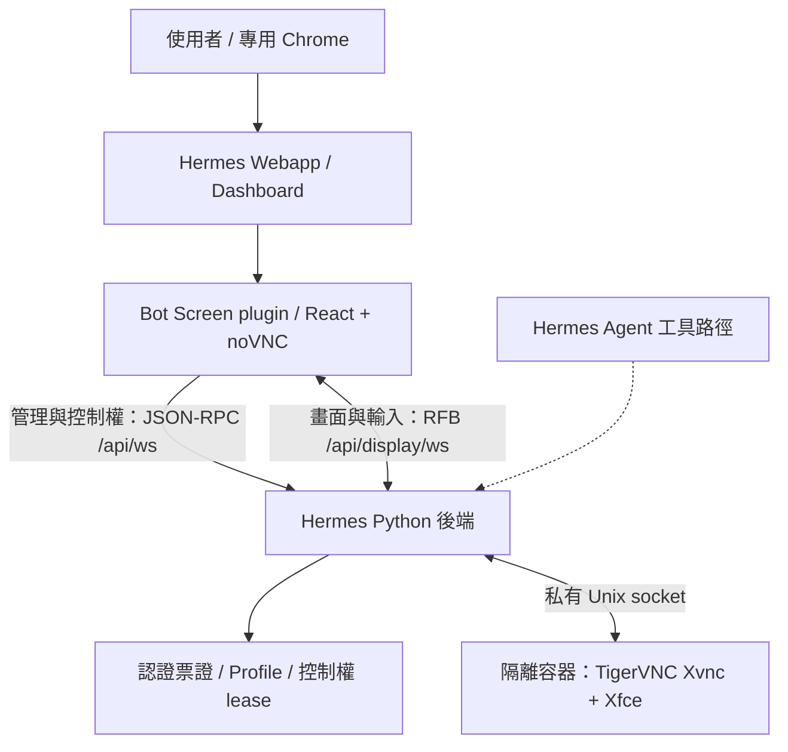

> **一鍵安裝 0.5.0：** Windows 完整解壓縮後雙擊 `Install.cmd`；Linux 執行 `bash install.sh`。前後端修正、隔離 profile、備份與回復已整合，請先看 [ONE_CLICK.md](ONE_CLICK.md)。下文保留架構與手動／舊版安裝說明。

# Bot Screen：Hermes 的桌面橋接與 Web 操作介面

Bot Screen 讓使用者在 **Hermes Webapp 裡觀看與操作隔離的 Linux 桌面**，並管理人工與 Agent 之間的控制權。

這個專案夾包含經隱私清理的 Hermes 原始碼快照、Bot Screen Dashboard plugin、隔離環境啟動腳本，以及實際操作的測試與證據。它包含一鍵安裝包 0.5.0，已在 Windows／Docker 與 Linux 原生模式的隔離環境完成安裝、重複安裝及回復驗證；不同實體電腦與所有 Linux 發行版仍須通過安裝時的相容性檢查。

**安裝到既有 Hermes：優先使用 [ONE_CLICK.md](ONE_CLICK.md)**，Windows 雙擊 `Install.cmd`，Linux 執行 `bash install.sh`。`scripts/install-plugin.py` 是僅更新前端的舊式進階入口。

可直接使用小型 [一鍵安裝包 0.5.0](dist/bot-screen-hermes-one-click-0.5.0.zip)，不必搬走完整 Hermes 原始碼。它不含 profiles、密碼、依賴快取或測試報告。

本份已移除作者聯絡對照資料與已辨識個人路徑，保留 LICENSE 和第三方聲明。原始稽核紀錄保留在本機，不納入版本庫；第三方依賴及必要授權中的公開作者資訊仍保留。

## 主要功能

- 在 Dashboard 的 **Bot Screen** 頁面觀看真實桌面畫面。
- 啟動桌面、查詢狀態，以及重新建立畫面連線。
- 按「接管操作」使用滑鼠與鍵盤；按「交回控制權」恢復觀看模式。
- 異常斷線時保留人工控制權，重連後不自動開放輸入。
- 桌面區隨視窗大小填滿剩餘空間，支援全螢幕及 Esc 返回。
- 使用專用 profile、單次觀看票證與後端輸入檢查。

v0.3.0 另加入引導空白狀態、單一主要動作、人工操作色框、鍵盤選單與連線逾時重試。次要工具集中到「更多操作」，介面與驗證見 [UI/UX 紀錄](evidence/UI_UX_REVIEW.md)。

目前展示的是 **Linux 容器桌面**，尚未完成完整 VM 或原生 Windows 桌面驗收，也沒有驗證模型自主操作桌面的端到端任務。

## 整體架構



兩條 WebSocket 分別處理「啟停、狀態、接管」與「畫面、鍵盤滑鼠」。輸入是否放行由後端決定，並非只靠前端的觀看模式。圖中的 Agent 工具路徑是 Hermes 架構的一部分，本次驗收沒有呼叫模型。

**Hermes Webapp 與 Desktop 是兩套前端。**這次整合的入口是瀏覽器 Webapp；`hermes/apps/desktop/` 保留 Electron Desktop 原始碼供參考，尚未針對本專案建置與驗收。

## 專案夾包含什麼？

```text
bot-screen/
├─ README.md                         專案介紹與使用入口
├─ INTEGRATION.md                    隔離環境、重建及驗證細節
├─ ARCHITECTURE.md                   Desktop / Webapp 架構分析
├─ bot-screen-plugin/                本專案的 Bot Screen 外掛
│  ├─ src/plugin.mjs                 React 頁面、接管、重連、全螢幕
│  ├─ src/screen.mjs                 RPC client、觀看票證與控制權操作
│  ├─ dashboard/manifest.json        Dashboard 外掛註冊資訊
│  ├─ dashboard/dist/index.js        已建置的外掛 bundle
│  ├─ dashboard/LICENSE.novnc.txt    noVNC 授權說明
│  ├─ tests/                        外掛邏輯測試
│  └─ package.json / package-lock.json
├─ hermes/                           經隱私清理的上游快照及本地修復
│  ├─ web/                          React Dashboard / Webapp
│  ├─ apps/desktop/                 Electron Desktop 原始碼
│  ├─ apps/shared/                  前端共用協定與工具
│  ├─ hermes_cli/                   CLI 與 FastAPI 後端
│  │  ├─ web_routers/display.py      畫面串流橋接與輸入檢查
│  │  └─ web_dist/                  本機建置的 Webapp 靜態產物
│  ├─ tui_gateway/                  JSON-RPC 與 display.* 方法
│  ├─ tools/bot_desktop/            桌面啟停、程序識別、lease、RFB 過濾
│  ├─ agent/、providers/、gateway/   Agent、模型與訊息平台基礎
│  ├─ plugins/、skills/、tests/      上游擴充與測試
│  └─ LICENSE                       Hermes 上游授權
├─ scripts/                          啟停、瀏覽器入口、環境準備與驗收工具
├─ evidence/                         截圖、測試報告與歷史失敗紀錄
├─ .runtime/                         本機 runtime 建置暫存
├─ integration-changes.json          本地修復與外掛內容雜湊紀錄
├─ source-manifest*.json             上游原始碼檔案清單
├─ verification.json                最初搬入時的完整性結果
├─ source-verification-current.json  後續來源核對結果
└─ verify-source.py                  原始碼完整性核對工具
```

`hermes/` 保留 monorepo 的開發結構，是為了維持 npm workspace、Python import 與共用協定的相對路徑；不是每個上游功能都由 Bot Screen 使用。這是原始碼快照，沒有上游 `.git` 歷史。作者聯絡目錄及對照資料已移除或清空，因此不把上游 release attribution／完整 CI 當成本份交付的驗收範圍。

目前資料夾也有後續產生的 `node_modules/`、建置產物與 `.runtime/` 快取。這些是本機依賴，並非日常 Hermes 的個人資料；原始搬入沒有複製日常 Hermes 金鑰、對話與設定。

## 快速啟動：目前這台電腦

前提：Docker Desktop 正在運作，且已有本機 runtime image 與前端建置產物。

```powershell
# 在本專案根目錄執行

# 啟動專用容器與 Dashboard；已啟動時可重複執行
powershell -NoProfile -ExecutionPolicy Bypass -File scripts\start-isolated.ps1

# 開啟已登入、最大化的專用 Chrome
node scripts/open-browser.mjs
```

專用網址：[http://127.0.0.1:9124/bot-screen](http://127.0.0.1:9124/bot-screen)。直接用另一個瀏覽器開啟可能需要登入；browser launcher 會在程序內完成專用登入，不需手動複製密碼。

操作順序：首次按 **啟動並觀看**，已有桌面則按 **觀看畫面 → 接管操作 → 交回控制權**。斷線時使用畫面中的「重新連線」；維護工具位於「更多操作」。重連後預設為觀看模式，全螢幕可按 Esc 返回。

停止環境：

```powershell
powershell -NoProfile -ExecutionPolicy Bypass -File scripts\stop-isolated.ps1
```

停止會保留容器內的測試 profile；刪除容器則會失去這份測試資料。

## 環境與資料放在哪裡？

| 項目 | 位置／名稱 | 隨專案夾一起複製？ |
|---|---|---|
| 原始碼、外掛、腳本、文件 | 本專案夾 | 是 |
| 已下載依賴與建置產物 | `node_modules/`、Webapp 與 plugin 的 dist | 實體複製可包含，依賴建議在新環境重建 |
| Docker runtime image | Docker 內的 `bot-screen-integration-runtime:local` | **否，需另外匯出或重建** |
| 運作容器 | Docker 內的 `bot-screen-integration` | 否 |
| 隔離 profile | 容器內 `/lab/profiles/bot-screen-lab` | 否 |
| 專用測試登入資料 | 容器內 `/lab/test-login.json` | 否，首次建立時重新產生 |
| runtime 建置暫存 | `.runtime/` | 通常不需複製，不能單獨取代 Docker image |

容器只發布宿主的 `127.0.0.1:9124`。原始碼、plugin 與腳本以唯讀方式掛入，沒有掛入日常 Hermes home、Docker socket 或一般 Chrome 使用者資料。這是測試隔離範圍的描述，不代表容器是完整 VM。

## 使用的 framework 與 library

| 層 | 技術 | 用途 |
|---|---|---|
| Webapp | React、TypeScript、Vite、React Router | Dashboard、頁面與建置 |
| UI | Tailwind CSS、`@nous-research/ui` | 樣式與共用元件 |
| 外掛 | 宿主 React SDK、JavaScript modules | 桌面頁面與操作狀態 |
| 畫面 client | `@novnc/novnc` 1.5.0 | RFB 解碼、顯示、鍵盤滑鼠輸入 |
| 外掛建置 | esbuild 0.25.12 | Dashboard 可載入的 bundle |
| 後端 | Python、FastAPI、Uvicorn、asyncio | API、WebSocket 與雙向串流 |
| 桌面 | TigerVNC Xvnc、Xfce | 真實 Linux 桌面與 framebuffer |
| 環境 | Docker Desktop | 專用 Linux 容器 |
| 驗證 | Playwright 1.56.1、Node test runner、unittest／pytest | 瀏覽器、輸入與後端回歸 |

完整鎖定版本以各目錄的 lockfiles 與相關依賴檔為準。

## 本專案的修改

1. 將 lab 外掛移入 `bot-screen-plugin/`，沿用 Dashboard 的載入與認證 SDK。
2. 加入明確重連、profile／viewer 控制權事件檢查，以及接管失敗時禁止輸入的處理。
3. 將畫面區改為填滿剩餘空間，加入全螢幕及最大化的專用 Chrome 入口。
4. 在 `hermes/tools/bot_desktop/runtime.py` 移植 Linux 程序識別修復，避免 psutil 時間漂移造成存活桌面被誤判停止。
5. 加入隔離啟停、測試視窗、端到端驗收、截圖與報告。

Hermes 基底 commit：`62629e285614db8cdcc9c48b6732b89d584def68`。最初逐檔核對 19,699 個追蹤檔案；隱私清理移除 2,002 個聯絡對照資料檔，目前保留 17,697 個上游檔案。核對紀錄包含清理排除項目與本地修改，不再保存原始使用者路徑及已移除的 email 檔名。本地修復與外掛雜湊見 `integration-changes.json`；這些紀錄不是版本控制的替代品。

## 驗證結果與範圍

2026-10-27 的本機驗收：

- 真實 1440×900 畫面；觀看時禁止輸入，接管後文字進入 Linux 視窗，交回後再次阻擋。
- 異常 WebSocket 斷線後保留人工控制權，三輪重連都回到同一個桌面程序。
- 單次票證重播與未登入的受保護 API／串流存取被拒絕。
- 38 項後端回歸、8 項外掛測試、9 項程序識別測試通過。
- 1280×720、1600×900、1920×1080 與全螢幕版面驗證通過。

| 證據 | 內容 |
|---|---|
| [evidence/QA.md](evidence/QA.md) | 驗收摘要、修復與限制 |
| [evidence/acceptance.json](evidence/acceptance.json) | 最近一次端到端驗收結果 |
| [evidence/summary.json](evidence/summary.json) | 測試總結 |
| [evidence/layout-check.json](evidence/layout-check.json) | 自適應版面與全螢幕結果 |
| [evidence/reconnected.png](evidence/reconnected.png) | 真實桌面重連截圖 |
| `evidence/*failure*.json`、`*diagnostics*` 等 | 開發過程的歷史紀錄，不是最終結論 |

斷線驗證使用 WebSocket 異常關閉 code 4002，並非實際拔除網路。尚未驗證乾淨主機安裝、完整 VM、原生 Windows 桌面、Electron Desktop、多使用者併發或長時間穩定性。

## 複製到另一台電腦

**可以複製程式碼，但單獨複製資料夾不會搬走 Docker image 與容器資料。**

建議保留 `hermes/`、`bot-screen-plugin/`、`scripts/`、根目錄文件、lockfiles 與授權；需要驗收歷史時再帶上 `evidence/` 與 manifests。`node_modules/`、Python 環境與 `.runtime/` 通常可略過並重建。

新電腦需準備 Docker Desktop、符合上游 engines 的 Node.js，以及 Chrome。現有 browser scripts 指定 Windows Chrome 路徑 `C:/Program Files/Google/Chrome/Application/chrome.exe`；不同安裝位置或作業系統需修改。

可在原電腦另行匯出 runtime image，再搬到新電腦匯入：

```powershell
# 原電腦，輸出檔需自行帶到新電腦
docker image save --output bot-screen-runtime.tar bot-screen-integration-runtime:local

# 新電腦
docker image load --input bot-screen-runtime.tar
```

這裡僅提供方法，沒有執行匯出。image 不包含原容器的 profile；新容器會建立新的專用測試資料。

也可執行 `python scripts/prepare-runtime.py` 重建 image，但**目前依賴原主機的 lab 容器與基底 image**，不能當成乾淨電腦的獨立安裝器。詳細限制見 [INTEGRATION.md](INTEGRATION.md)。

## 重新建置與測試

從專案根目錄執行：

```powershell
# Hermes Webapp：使用符合上游要求的 npm，不更動全域 npm
Set-Location hermes
npx.cmd --yes npm@11.17.0 ci --workspace web --workspace @hermes/shared --ignore-scripts --no-audit --no-fund
node scripts/build/web.mjs

# Bot Screen plugin
Set-Location ../bot-screen-plugin
npm.cmd ci --ignore-scripts --no-audit --no-fund
npm.cmd run build
npm.cmd test

# 隔離服務已啟動後，驗證真實桌面
Set-Location ..
node scripts/acceptance.mjs
```

E2E 會建立／替換專用測試視窗、輸入合成文字並測試控制權，請在沒有手動操作這個隔離桌面時執行。它不是唯讀檢查。

| 腳本 | 工作 |
|---|---|
| `start-isolated.ps1` / `stop-isolated.ps1` | 專用容器與 Dashboard 啟停 |
| `open-browser.mjs` | 開啟已登入且最大化的專用 Chrome |
| `install-plugin.py` | 能力檢查及部署 plugin 到既有 Hermes 隔離 profile |
| `bootstrap.py` / `server.py` | 隔離 profile、登入資料與服務初始化 |
| `prepare-runtime.py` / `Dockerfile.runtime` | 依既有 lab 準備本機依賴 image |
| `fixture.py` / `input-fixture.tcl` | 真實桌面輸入的測試視窗 |
| `acceptance.mjs` | 瀏覽器、控制權與斷線重連驗收 |
| `identity_regression.py` | Linux 程序識別回歸 |
| `report.py` | 依測試產物產生摘要與內容雜湊紀錄 |

`python verify-source.py` 使用隨附且已清理的 manifest 核對保留檔案，不再依賴原主機路徑。需要獨立 Git 基準時可加 `--source /path/to/upstream-checkout`。它只核對來源完整性，不代替建置或執行驗收。

## 進一步閱讀與授權

- [INTEGRATION.md](INTEGRATION.md)：實際整合、隔離環境、重建與驗證細節。
- [INSTALL_HERMES.md](INSTALL_HERMES.md)：安裝到既有 Hermes 的完整步驟與相容性限制。
- [ARCHITECTURE.md](ARCHITECTURE.md)：Desktop、Webapp、共用協定與後端分析；保留初始搬入階段的歷史狀態。
- [hermes/LICENSE](hermes/LICENSE)：Hermes 上游 MIT 授權。
- [noVNC 授權說明](bot-screen-plugin/dashboard/LICENSE.novnc.txt)：noVNC 核心為 MPL 2.0，其他組件依該檔案說明。

複製或再散布時請保留相關授權與第三方聲明。本專案目錄沒有額外宣告一份涵蓋所有本地新增程式的統一授權。


## 多國語言（v0.4.0）

Bot Screen 支援繁體中文、簡體中文與 English。進入 Bot Screen，開啟右上角「更多操作（•••）」→「語言」，選擇語言或「跟隨 Hermes」。預設跟隨 Dashboard 的語言設定；不支援的語言回退英文。沒有宿主語言時才參考瀏覽器語言。

語言偏好只儲存在目前網站的瀏覽器 localStorage（`bot-screen:language:v1`），不修改 Hermes 的語言、帳號或隔離 profile。切換語言會立即更新按鈕、輔助標籤、狀態與已顯示的訊息，保留現有桌面連線及控制權。已知前端錯誤有翻譯；後端原始錯誤保留在本地化提示中，方便排查。

翻譯檔位於 `bot-screen-plugin/src/locales/`，語言解析及回退邏輯位於 `src/i18n.mjs`。新增語言時補齊相同訊息鍵與參數，再加入語言清單及別名解析，執行單元測試與建置。沒有新增執行期套件。

多國語言前端與 Windows／Docker 後端修正已安裝到日常 Dashboard（9119），並通過真實畫面、接管／交回與三輪異常斷線重連驗收。隔離 Linux Dashboard（9124）回歸通過；跨平台範圍與安裝方式見 CROSS_PLATFORM.md。


Windows／Docker 後端的跨平台適配、補丁與驗收範圍，見 [CROSS_PLATFORM.md](CROSS_PLATFORM.md)。前端外掛更新與後端核心補丁是兩個步驟；後端變更必須重啟實際監聽 Dashboard 連接埠的程序。


## Git 版本管理

遠端：[brianShih/hermes-dashboard-botscreen](https://github.com/brianShih/hermes-dashboard-botscreen)，主要分支 `main`。

版本庫納管已清理的 Hermes 快照、Bot Screen 原始碼／預建置 bundle、安裝器、後端修正、文件及指定的可攜驗收摘要。`.runtime/`、`.privacy-audit/`、node_modules、使用者設定／備份／日誌及其他機器資料不提交。Hermes 快照保留 LICENSE 與來源核對資訊，允許平台換行格式差異；來源版本及核對方式見 `source-manifest.json`、`verify-source.py`。

一般修改流程：建立功能分支，完成測試後提交，再合併回 `main`。不要使用 `git add -f` 將忽略的備份或憑證加入版本庫。

```powershell
git switch -c feature/your-change
python -m unittest discover -s scripts/tests -v
node --test bot-screen-plugin/tests/*.test.mjs
git add <modified-files>
git commit -m "Describe the change"
git push -u origin feature/your-change
```

驗收明細中提到的截圖及部分報告是本機產物，需在相同環境重新產生；不是 Git clone 後就具備的服務或帳號狀態。
